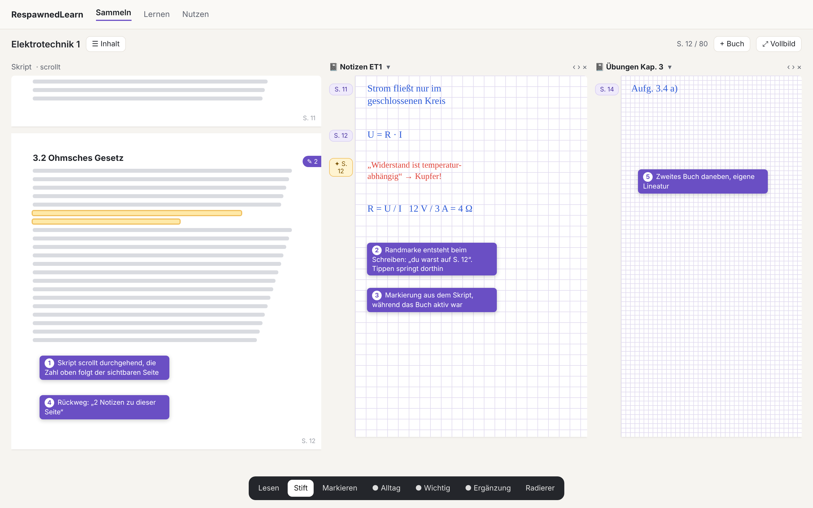
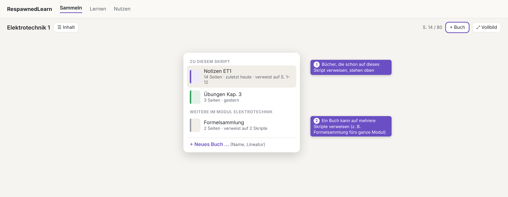
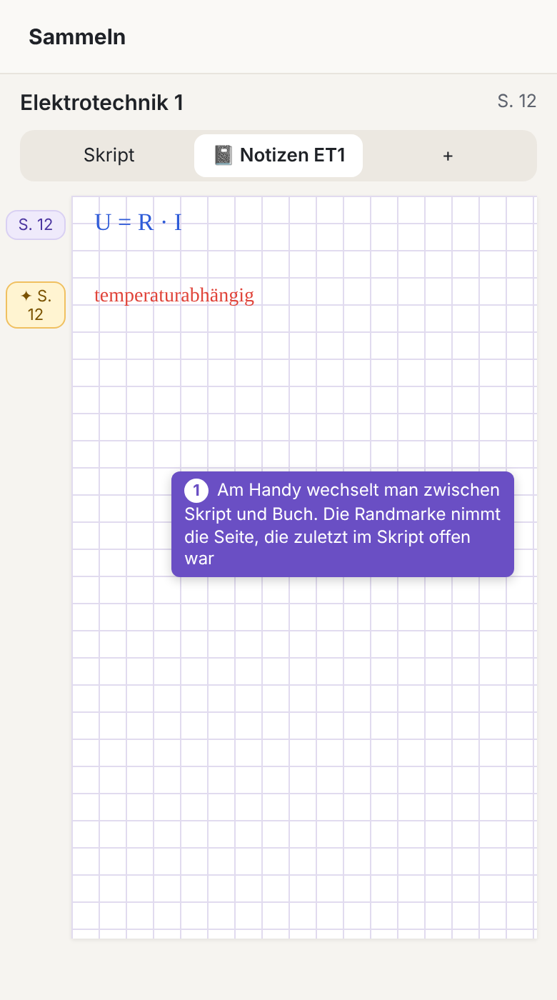

> **Stand 2026-11-13:** komplett gebaut (Schritt 1 v0.12.0, 2 v0.13.0, 3 v0.14.0, 4 v0.15.0; ✦-Marken v0.17.0). Die Fragen unten sind beantwortet; der Text bleibt als Begründung der Entscheidungen.

# Notizbücher neben dem scrollenden Skript (Konzept, RespawnedLearn)

Stand 2026-11-13, Grundlage v0.11.1. Noch kein Code; alles hier wartet auf Nils' Okay.

**Was durch „tiefer, nicht größer“ anders läuft:** Ich habe vom echten Code und Vertrag aus geplant (heute hängt jedes
Blatt an einer Skriptseite: `lernen/blaetter/<pdf>/S012-<blatt>.svg`), nicht von einer Wunschliste. Die Verknüpfung
lehnt sich an bewährte Werkzeuge an, die genau das automatisch tun (OneNote „Verknüpfte Notizen“, Notability, Zotero),
und die Migration wird so gebaut, dass sie mit echtem Syncthing auf zwei Geräten gleichzeitig laufen kann, ohne
Konfliktkopien oder doppelte Bücher, belegt durch eine SHA-256-Liste vorher und nachher.

## 1. Problem und Abnahme

**Alltag:** Seitenweise blättern unterbricht das Lesen, und jede Skriptseite bekommt ein eigenes leeres Blatt. Wer
vor allem im Skript notiert, hat lauter leere Flächen; wer viel schreibt, hat seine Gedanken über 80 Einzelblätter
verstreut. Lesen und Schreiben gehören nebeneinander, aber nicht Seite für Seite aneinander gekettet.

**Abnahme (Vorschlag):**
1. Das Skript scrollt durchgehend. Die Seitenzahl oben folgt der sichtbaren Seite, beim Öffnen steht es an der zuletzt
   gelesenen Stelle. Es gibt kein Blatt je Skriptseite mehr.
2. Beliebig viele Notizbücher lassen sich anlegen, wählen und nebeneinander öffnen (PC) bzw. umschalten (Handy). Jedes
   Buch hat seine Lineatur, scrollt für sich und hängt am Ende von selbst eine Seite an.
3. Beim Schreiben im Buch entsteht am Rand eine Marke „S. 12“ zur Skriptseite, die gerade offen war (Regel in 4).
   Tippen auf die Marke scrollt das Skript dorthin. Umgekehrt zeigt die Skriptseite „✎ 2“, und Tippen öffnet das Buch
   an der Stelle.
4. Eine Markierung im Skript, die entsteht, während ein Buch aktiv ist, erscheint auch im Buch (Form: Frage 3).
5. Bisherige seitengekoppelte Blätter erscheinen nach der Migration als Bücher, nur mit den beschriebenen Seiten, jede
   mit Verweis auf ihre Skriptseite. Die Tinte ist byte-gleich (SHA-256-Liste), die alten Dateien bleiben unberührt,
   und zwei Geräte, die gleichzeitig migrieren, erzeugen keine Konfliktkopie (geprüft mit echtem Syncthing).
6. Messung: Ein 300-Seiten-Skript öffnet nicht langsamer als heute eine Einzelseite (+10 % Toleranz), und der
   Speicher am Android-Gerät bleibt beim Durchscrollen begrenzt (gezeichnete Seiten weit außerhalb werden freigegeben).

**Was wegfällt:** die Seitenknöpfe ‹ › (Bild-auf/ab und Pfeiltasten scrollen weiter seitenweise), Blätter je
Skriptseite, „+ Platz nach unten“ (das Buch wächst selbst), die Lineatur-Auswahl im Kopf jeder Ansicht (wandert ins
Buch-Menü) und im Vollbild „ganze Seite passt auf den Schirm“ (wird „Breite passt“).

## 2. Vorbilder und Forschung

| Vorbild | Was es macht | Was wir übernehmen |
|---|---|---|
| OneNote „Verknüpfte Notizen“ (Desktop) | Notizen am Rand angedockt; jeder Absatz bekommt automatisch einen Link auf das Dokument bzw. die Seite, die beim Schreiben offen war | genau unser Kern: Verweis entsteht beim Schreiben, ohne Zutun |
| Notability (Audio-Sync) | Tinte ist mit der Zeitmarke der Aufnahme verknüpft; Tippen auf die Schrift spielt die Stelle ab | Schrift ↔ Quelle über eine Marke, nicht über feste Seitenpaare |
| LiquidText, MarginNote | Ausschnitte aus dem PDF landen im Arbeitsbereich und bleiben mit der Stelle verbunden, in beide Richtungen | Markierung → Buch, Rückweg vom Skript zum Buch |
| Zotero 7 | „Notiz aus Anmerkungen“: Markierungen werden Teil der Notiz, jede mit Link zurück ins PDF | Markierungen während des Notierens landen in der Notiz |
| GoodNotes | Links zwischen Seiten, aber von Hand gesetzt | bewusst nicht: von Hand verknüpft macht im Alltag niemand |

**Lernforschung** (so ehrlich wie die Belege sind):
- **Generatives Lernen** (Fiorella & Mayer 2016, Educational Psychology Review 28): Zusammenfassen, Skizzieren, sich
  selbst erklären wirkt, Abschreiben kaum. Eigene Bücher statt einem Blatt neben jeder Seite laden dazu ein, in eigenen
  Worten und in eigener Ordnung zu schreiben (Übungen in einem Buch, Gedanken in einem anderen).
- **Handschrift vs. Tippen** (Mueller & Oppenheimer 2014; Replikation Morehead, Dunlosky & Rawson 2019): Der Vorteil
  der Hand ist kleiner und weniger sicher als oft behauptet. Was zählt, ist das verarbeitende Schreiben, nicht der
  Stift. Darum keine Abschreibhilfe, aber kurze Wege.
- **Räumliche Nähe / Split-Attention** (Ginns 2006, Meta-Analyse, Learning and Instruction 16): Zusammengehöriges
  nebeneinander und verknüpft entlastet das Arbeitsgedächtnis. Das stützt Skript und Buch nebeneinander plus Marken,
  die den Suchweg sparen.
- **Speicherfunktion von Notizen** (Kiewra 1989): Notizen helfen vor allem, wenn man sie später wieder durchgeht.
  Der Verweis „S. 12“ macht dieses Wiederholen schnell, weil der Zusammenhang einen Tipp entfernt ist.

## 3. Bedienung (Skizzen)



1. Das Skript scrollt; „S. 12 / 80“ oben folgt der Seite, die den meisten Platz einnimmt. Tippen darauf öffnet
   „Gehe zu Seite“ bzw. das Inhaltsverzeichnis.
2. Die Randmarke steht außerhalb des Papiers, damit sie nie mit Schrift kollidiert und der Handballen sie nicht trifft.
3. Gelbe Marke ✦ = Markierung aus dem Skript (Frage 3).
4. Am Rand der Skriptseite steht „✎ 2“, wenn Bücher auf diese Seite verweisen.
5. Mehrere Bücher nebeneinander, Breite ziehbar, Reihenfolge wählbar wie heute.



„+ Buch“ ersetzt „+ Blatt“. Oben stehen die Bücher, die schon auf dieses Skript verweisen, darunter die übrigen des
Moduls, am Ende „Neues Buch“ mit Name und Lineatur. Ein Buch gehört nicht fest zu einem Skript: eine Formelsammlung
kann auf mehrere Skripte verweisen.



Am Handy stehen heute Skript und Blatt untereinander. Mit scrollendem Skript wären das zwei Scrollflächen
übereinander, das bedient sich schlecht. Vorschlag: ein Umschalter „Skript | Buch | +“ (Frage 4).

## 4. Wann eine Randmarke entsteht

„In technisch sinnvollen Abständen“ heißt hier: genau dann, wenn sich der Zusammenhang ändert, nicht nach Uhr.

- **Offene Skriptseite:** die Seite mit dem größten sichtbaren Anteil im Skript dieses Übungsplatzes. Sie zählt erst,
  wenn sie 2 Sekunden stehen bleibt, damit Durchscrollen keine Marken erzeugt. Am Handy gilt die zuletzt im Skript
  sichtbare Seite.
- **Regel beim Absetzen eines Strichs:** Die App sucht auf derselben Buchseite die nächste Marke oberhalb des
  Strichs. Zeigt sie auf dieselbe Skriptseite, passiert nichts. Sonst (andere Seite, anderes Skript oder noch keine
  Marke auf dieser Buchseite) entsteht eine neue Marke auf Höhe des Strichanfangs.
  Ergebnis: jede Buchseite beginnt mit ihrem Bezug, und jeder Seitenwechsel im Skript wird sichtbar, sobald man
  weiterschreibt. Liegen zwei Marken zu dicht (unter einer Zeile), rückt die neue nach unten.
- **Ohne Skript** (Buch allein offen, oder Skript ausgeblendet): keine Marke.
- **Radieren:** Eine automatische Marke, unter der bis zur nächsten Marke kein Strich mehr steht, räumt die App beim
  nächsten Schreiben weg; sie ist abgeleitet, keine Nutzereingabe. Marken aus Markierungen bleiben, bis man sie
  antippt und entfernt.
- **Gespeichert** wird mit der Tinte zusammen (1 s Ruhe wie heute), also keine zusätzlichen Schreibvorgänge pro Strich.

## 5. Markierungen ins Buch

Ein Buch ist **aktiv**, wenn es offen ist und in den letzten 15 Minuten darin geschrieben wurde (bei mehreren: das
zuletzt beschriebene). Entsteht dann im Skript eine Markierung, kommt sie unter die letzte Zeile der aktiven Buchseite.

| Variante | Im Buch erscheint | Für | Gegen |
|---|---|---|---|
| A Randmarke | nur „✦ S. 12“ am Rand, Tippen zeigt die Stelle | stört das Schreiben nie | der Inhalt steht nicht in der Notiz |
| **B Ausschnitt (Empfehlung)** | die markierte Stelle als kleines Bild, darunter schreibt man weiter, plus Randmarke | erfüllt „landet in der Notiz“ wörtlich; nutzt das vorhandene Format für PDF-Ausschnitte (kein Bild wird kopiert, nur Seite + Bereich) | belegt Platz; lässt sich aber wie jedes Blattbild verkleinern, verschieben, entfernen |
| C Text | der markierte Text als getippte Zeile | durchsuchbar | bei Scans ohne Textebene leer, getippter Text in Handschrift wirkt fremd |

## 6. Datenformat (Vertrag Lernen 1.3)

Neuer Typ **`notizbuch`**, ein Ordner je Buch, eine Datei je Seite (kleine Dateien = Syncthing-Konflikte bleiben auf
eine Seite begrenzt):

```
lernen/buecher/<id>.md            Steckbrief des Buchs (Frontmatter, Pflichtfelder wie 3)
lernen/buecher/<id>/S001.svg      Tinte der Buchseite 1 (Format 5.4), mindestens A4 hoch, wächst nach unten
lernen/buecher/<id>/S001.json     Bilder und Verweise dieser Buchseite
```

```yaml
---
id: 01JNB8…
typ: notizbuch
titel: Übungen Kap. 3
lineatur: kariert        # wie 5.3
modul: elektrotechnik    # optional, nur zum Ordnen
erstellt: 2026-11-13
schema: 1
---
```

```json
{"bilder":   [{"id": "m2c8r7tb", "anhang": "01JSKRIPT…", "seite": 12, "bereich": {"x": 0.1, "y": 0.2, "b": 0.5, "h": 0.1},
               "x": 48, "y": 380, "b": 600, "h": 120}],
 "verweise": [{"id": "v3k9", "y": 96,  "anhang": "01JSKRIPT…", "seite": 12, "am": "2026-11-13T10:42:00+01:00"},
              {"id": "v4p1", "y": 380, "anhang": "01JSKRIPT…", "seite": 12, "marke": "a7k2c9", "am": "2026-11-13T10:44:10+01:00"}]}
```

- `y` in Seitenkoordinaten der Buchseite (Breite 1000). `marke` verweist auf die Zeile in `lernen/markierungen/`
  (5.4), sonst ist es eine automatische Marke.
- Seiten heißen fortlaufend. Unter der letzten beschriebenen Seite zeigt die App immer eine leere an; die Datei
  entsteht erst mit dem ersten Strich. Es gibt also nie leere Seitendateien.
- `anordnung.json` je Skript bleibt, mit neuer Art `{"art": "buch", "buch": "<id>", "breite": 1}` statt
  `{"art": "blatt", …}` (Feld `schema: 2` in der Anordnung).
- Der Rückweg „✎ 2“ wird aus allen `S*.json` der Bücher im Arbeitsspeicher berechnet (Textdateien sind ohnehin
  vollständig geladen), kein eigener Index im Ordner.
- Wissen wird nie gelöscht: Ein Buch lässt sich schließen und archivieren, nicht löschen (Grundlagen 7).

## 7. Migration der seitengekoppelten Blätter

Heute: je Skript `anordnung.json` mit Blättern (`id`, `lineatur`), Tinte `S012.svg` (Blatt 1) bzw. `S012-<blatt>.svg`,
Bilder `S012-bilder.json` mit Feld `blatt`. Nils' eigene Lerndaten kommen erst mit Schritt 5 aus VX, also muss die App
das alte Format ohnehin verstehen.

| | M1 Verweisen statt kopieren | **M2 einmal anheben (Empfehlung)** |
|---|---|---|
| Vorgehen | Buch listet die alten Dateien als seine Seiten, liest und schreibt sie an Ort und Stelle | beim ersten Öffnen des Skripts wird jedes Blatt zu einem Buch: nur Seiten mit Tinte oder Bild, in Seitenreihenfolge, Tinte byte-gleich kopiert, je Seite ein Verweis `y: 0` auf ihre Skriptseite |
| Risiko | null Bytes bewegt | Kopie, aber alte Dateien bleiben unberührt als Archiv |
| Folgekosten | zwei Formate für immer im Code und im Vertrag | danach nur noch ein Format |

**Damit zwei Geräte gleichzeitig migrieren können:** Die Buch-ID ist nicht zufällig, sondern abgeleitet
(`<pdf-id>-<blatt-id>`), die Seitennummern und Dateiinhalte sind deterministisch. Beide Geräte schreiben dann
inhaltsgleiche Dateien. Ob Syncthing gleichzeitig entstandene, inhaltsgleiche Dateien ohne Konfliktkopie zusammenführt,
prüfe ich wie in Schritt 2 gegen echtes Syncthing, statt es anzunehmen. Ein „Buch ohne PDF“ (Heft) wird ein Buch ohne
Skriptbezug (Frage 5).

## 8. Geänderte Dateien, Tests, Bauschritte

| Schicht | Datei | Änderung |
|---|---|---|
| Vertrag | `typen.md` 5.3, `grundlagen.md` 2, `aenderungen.md`, `DATENVERTRAG.md` | Lernen 1.3, Migration M2 |
| kern | neu `buecher.ts` | Buch lesen/schreiben, Seiten, Verweise, Regel `brauchtVerweis()`, verwaiste Marken, Rückweg |
| kern | neu `buchMigration.ts` | alte Blätter → Bücher, deterministisch, rein |
| kern | `pfade.ts`, `blaetter.ts`, `bestand.ts` | Pfade, Anordnung `art: buch`, Bücher im Bestand |
| oberflaeche | `pdf/PdfAnsicht.tsx`, `pdf/Tinte.tsx` | `onSichtbareSeite`, Canvas weit außerhalb freigeben; Strich-fertig mit Höhe |
| app | `Sammeln.tsx`, neu `Buch.tsx`, neu `BuchWahl.tsx`, `Blaetter.tsx`, `Start.tsx` | Scrollen, Bücher, Randmarken, aktives Buch, Heft |

**Neue Tests:** `buecher.test.ts` (gleiche Seite → keine Marke, Seitenwechsel → Marke, neue Buchseite → Marke, zu
dicht → rückt, verwaiste Marke weg, Markierungsmarke bleibt); `buchMigration.test.ts` (Tinte byte-gleich, leere Seiten
fallen weg, Reihenfolge, alte Dateien unverändert, zweimal ausgeführt = gleiches Ergebnis); Speichertest mit zwei
Geräten auf der nachgestellten Platte (gleichzeitige Migration ohne Konfliktkopie); Messung Öffnen/Scrollen mit 300
Seiten vorher und nachher (p95).

**Bauschritte, je ein Push mit Minor-Version:**
1. Skript scrollt (allein schon nützlich; bis Schritt 2 folgen die alten Blätter der sichtbaren Seite).
2. Bücher, Buchwahl, Vertrag 1.3, Migration.
3. Randmarken und Rückweg.
4. Markierungen ins Buch.

## 9. Offene Fragen (mit Empfehlung)

1. **Wem gehört ein Buch?** Fest einem Skript, einem Modul, oder frei? *Empfehlung:* frei, das Modul nur zum
   Ordnen; die Wahl zeigt zuerst die Bücher, die schon auf dieses Skript verweisen.
   **Entschieden (Nils 13.11.):** frei oder einem Modul zugeordnet. Das Feld `modul` ist optional; ein Buch mit Modul
   steht in der Wahl bei allen Skripten dieses Moduls und auf der Modulseite, ein freies Buch nur unter „Weitere“.
2. **Was zählt als Markierung?** Heute speichert „Markieren“ erst etwas, wenn man daraus eine Wissens- oder Lernkarte
   macht oder verlinkt. Sollen auch Rechtecke ohne Karte ins Buch gehen (dann bräuchte das Menü „Nur markieren“), und
   Striche mit dem Stift „Wichtig“ im Skript? *Empfehlung:* jede gespeicherte Markierung, plus neuer Knopf „Nur
   markieren“; Stiftstriche nicht. **Entschieden (Nils 13.11.):** wie empfohlen.
3. **Wie erscheint die Markierung im Buch?** A Randmarke, B Ausschnitt als Bild, C Text. *Empfehlung:* B. **Entschieden (Nils 13.11.):** B.
4. **Handy:** umschalten „Skript | Buch“ statt untereinander? *Empfehlung:* ja. **Entschieden (Nils 13.11.):** optional; am Handy
   wird kaum mitgeschrieben, es dient zum Lernen unterwegs. Darum: am Handy öffnet nur das Skript, ein Buch kommt
   über einen kleinen Umschalter dazu, und es wird dafür nichts Eigenes gebaut, was über Lesen und Antippen der
   Marken hinausgeht.
5. **„Buch ohne PDF“** wird künftig ein Notizbuch ohne Skript (kein leeres 60-Seiten-PDF mehr, Grenze 60 Seiten
   fällt)? *Empfehlung:* ja, bestehende Hefte migrieren mit. **Entschieden (Nils 13.11.):** ja.
6. **Migration** M1 oder M2? *Empfehlung:* M2. **Entschieden (Nils 13.11.):** M2.
7. **Randmarken links oder rechts?** Beim Linkshänder liegt der Handballen links vom Stift, rechts bleibt frei.
   *Empfehlung:* Rand gegenüber der Schreibhand, Standard rechts für dich, umstellbar in den Einstellungen. **Entschieden (Nils 13.11.):** ja. Umsetzung als Geräte-Einstellung
   „Schreibhand“; weil die App öffentlich ist, steht der Standard auf rechte Hand (Marken links), Nils stellt einmal
   „links“ ein.
